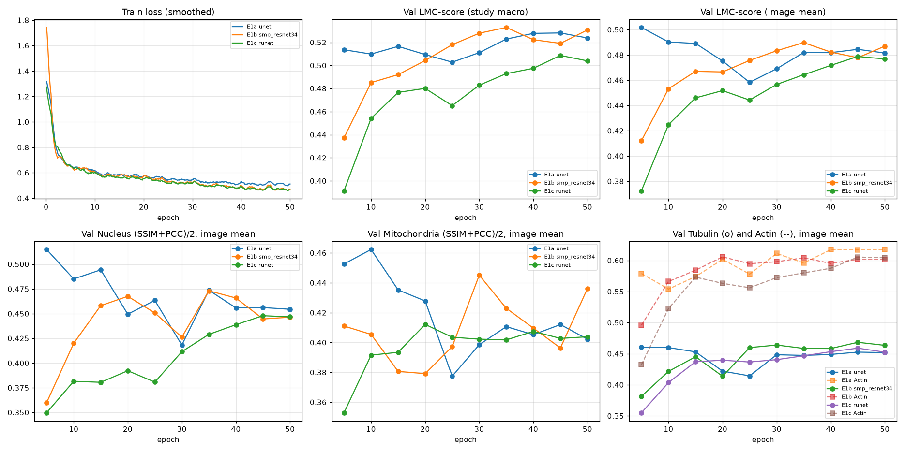

# LMC2 – Team handover: backbone screen (E1) and the E1b baseline

_Status 23 Nov 2026. Internal team note. All numbers are on **Val**. Test has not been used._

## 1. Task (confirmed by the professor)

| | |
|---|---|
| Input | The full transmitted-light (TL) z-stack of one image (BF, PC or DIC) |
| Output | 4 fluorescence images (Nucleus, Mitochondria, Tubulin, Actin), each at **that organelle's own best-focus plane** (`<Org>_best_z` in `Study_XX_best_focus.tsv`) |
| Not allowed at test time | Any best_z from the TSV (TL or organelle). The model sees only the TL stack and OME metadata. |
| Metric | Official LightMyCells SSIM and PCC per image × organelle, only where GT exists |
| Output format | OME-TIFF, same H×W as the input |

The organelle best_z is used only as a **training target** (it chooses which GT plane we learn), never as an input.

## 2. Data and split

- **28 studies on disk:** 02 03 04 05 06 07 20 21 25 42 51 56 57 58 62 64 72 73 76 77 78 79 80 81 82 83 84 86.
- **948 images → 924 usable → 932 samples** (Study 76 has BF and PC for the same image: one sample per TL modality).
- Excluded:

| What | Count | Why |
|---|---|---|
| Images with nZ = 1 | 20 (S04 ×16, S03 ×3, S02 ×1) | no z-stack to learn from |
| Images without a TL channel | 2 (S03) | no input |
| Images without any organelle best_z | 2 (S07) | no target |
| Nucleus and Actin labels of S03 images 53, 55, 56, 57 | labels only | the two planes are pixel-identical (label error); the images stay for their other organelles |

- Known label noise, kept as is: S03 img 60, S56 Nucleus, S02 img 43/422 Mito, S04 img 91 Tubulin.
- **Split by study** (`splits/split_v1.json`, fixed, never change it). Every modality and organelle appears in each part.

| Split | Studies | Samples | Use |
|---|---|---|---|
| Train (17) | 02 03 04 05 06 07 25 42 51 58 64 76 77 78 79 83 84 | 803 | training |
| Val (5) | 20 72 81 82 86 | 58 | model and checkpoint selection, all comparisons |
| **Test (6)** | 21 56 57 62 73 80 | 71 | **LOCKED: do not evaluate, do not look at it.** It is used once, at the end, on the final model. |

Note on S20 (Val): DIC with dz = 3 µm, far outside the training range (0.2–1 µm). Every model scores ~0.2–0.35 there, so we also report the LMC-score **without S20** (reporting only; selection always uses the full Val).

## 3. Pipeline

| Part | Setting |
|---|---|
| Cache (`tools/build_cache.py`) | Each TL stack is resampled to **K = 16 planes** (linear interpolation along z, uniform over the whole stack), so every organelle's best plane lies inside the input. Stored per image: 16 TL planes (uint16), the 4 GT best-focus planes, the organelle best_z (original and resampled), the label mask, metadata (modality, px, dz, nZ, H×W). 35 GB, ~22 min. The train studies can be copied to an SSD (`tools/mirror_cache.py`, 21 GB) because random patch reads from an HDD are ~30× too slow. |
| Normalisation | Per image, percentile 1–99.8 → [0, 1]: one (lo, hi) pair per TL stack, one per GT plane |
| Input / output | 16 planes as channels → 4 channels (one per organelle). Missing organelles are masked out of the loss. |
| Sampler | Study weight ∝ √(n_samples): keeps S25 (644 images) from dominating without starving it |
| Augmentation | 8 dihedral flips/rotations; random 512² patches |
| Loss | Masked L1 + 0.5·(1−SSIM) + 0.5·(1−PCC) (teammate's loss) |
| Training | 50 epochs × 100 steps = **5,000 steps**; micro-batch 2 × grad-accum 4 (effective 8); AdamW lr 1e-3, wd 1e-4; OneCycle (5 % warm-up); grad clip 1.0; **fp32** (fp16/bf16 are 4–8× slower on the GTX 1650); seed 0 |
| Evaluation | Full images, tiled inference (512 tiles, 128 overlap). Official SSIM/PCC. **LMC-score = mean over organelles of the study-macro mean of (SSIM+PCC)/2.** Val every 5 epochs; **`best.pt` = best full-Val LMC-score.** |
| Run manager | One folder per run `runs/<ID>_<name>_<date>/` (config + hashes + code snapshot, `train_log.csv`, `val_log.csv`, `curves.png`, `best.pt`, `last.pt`, `val_metrics.json`, `stdout.log`). Never overwrites; refuses a config that already finished; `--resume` continues mid-epoch; smoke runs go to `runs/_smoke/` and are never registered. |
| `runs/REGISTRY.csv` | One row per real run (config summary, status, best epoch, Val LMC full / image mean / without S20, per organelle, notes). Rebuilt by `tools/update_registry.py`. Check it before starting a run. |

## 4. Backbone screen (E1): same data, loss, schedule and seed; only the backbone changes

| Run | Backbone | Paper / code | Params | Time (GTX 1650) | Peak GPU |
|---|---|---|---|---|---|
| E1a | Plain 2D U-Net, random init (teammate's) | Ronneberger et al. 2015, [arXiv:1505.04597](https://arxiv.org/abs/1505.04597) | 7.8 M | 1h55m (1.12 s/step) | 2.3 GB |
| **E1b** | U-Net with ImageNet ResNet-34 encoder ([segmentation_models_pytorch](https://github.com/qubvel-org/segmentation_models.pytorch)); first conv adapted to 16 channels | ResNet: He et al. 2016, [arXiv:1512.03385](https://arxiv.org/abs/1512.03385) | 24.5 M | **1h33m** (0.86 s/step) | 2.1 GB |
| E1c | RUNet, residual encoder-decoder (3rd place LightMyCells 2024); one shared network with 4 outputs | Wodzinski & Müller, ISBI 2024, [arXiv:2406.01187](https://arxiv.org/abs/2406.01187), [code](https://github.com/MWod/LightMyCells) | 31.0 M | 2h31m (1.54 s/step) | 2.3 GB |

### Val results (best checkpoint of each run)

| Run | Best epoch | **LMC full Val** | LMC w/o S20 | LMC image mean | Nucleus | Mito | Tubulin | Actin | Last epoch |
|---|---|---|---|---|---|---|---|---|---|
| E1a | 45 | 0.5281 | 0.6161 | 0.4844 | 0.558 | 0.451 | 0.519 | **0.585** | 0.5238 |
| **E1b** | 35 | **0.5328** | **0.6208** | **0.4897** | **0.578** | **0.460** | **0.526** | 0.567 | **0.5306** |
| E1c | 45 | 0.5086 | 0.5843 | 0.4787 | 0.509 | 0.435 | 0.519 | 0.572 | 0.5039 |

Organelle columns are study-macro (SSIM+PCC)/2.

**Per modality** ((SSIM+PCC)/2, image mean over all organelles; n = image × organelle pairs):

| Modality | n | E1a | E1b | E1c |
|---|---|---|---|---|
| BF | 30 | 0.648 | **0.677** | 0.614 |
| PC | 70 | 0.591 | **0.594** | **0.594** |
| DIC | 79 | 0.301 | **0.305** | 0.301 |

DIC is weak for all three backbones. It is mostly S20 (dz = 3 µm); S86 DIC reaches 0.6–0.7.
Per organelle × modality and per study tables: `reports/E1_compare/summary.md`.

**Paired bootstrap** of the LMC-score difference (images resampled within study × organelle, 2000 draws):

| A − B | Δ | 95 % CI | P(A > B) |
|---|---|---|---|
| E1b − E1a | +0.005 | −0.002 … +0.011 | 0.92 |
| E1b − E1c | +0.024 | +0.013 … +0.035 | 1.00 |
| E1a − E1c | +0.020 | +0.008 … +0.031 | 1.00 |

**Curves** (`reports/E1_compare/curves_compare.png`; E1b alone: `runs/E1b_smpr34-k16_20261121-1317/curves.png`):



- E1a is flat on Val from epoch 5 (0.51 → 0.53). Its image-mean score peaks at epoch 5, then mostly drops.
- E1b rises steadily to 0.533 at epoch 35 and ends at 0.531. It is the most stable of the three in the second half.
- E1c starts lowest (0.39) and climbs slowly to 0.509. It is still behind at epoch 50.
- Train losses are close; E1a ends highest (~0.51 vs ~0.47).

Best epochs were selected on this same Val set, so all Val scores are slightly optimistic.

## 5. Conclusion: we continue with E1b

- Best full-Val LMC-score (0.533), best without S20 (0.621), best on BF and best on 3 of 4 organelles.
- Clearly better than RUNet (+0.024, CI excludes 0). Against the plain U-Net the gain is small and not significant (+0.005), but E1b also has the most stable curve and the best last-epoch score.
- Fastest (1h33m, 0.86 s/step) and lowest memory (2.1 GB): the cheapest base for further experiments on a 4 GB GPU.
- The pretrained encoder gives the best features for BF/PC nuclei and tubulin.

## 6. Already tried on top of E1b (do not repeat)

Full-Val LMC-score at the best epoch; Δ vs E1b (0.5328) with the 95 % bootstrap CI. Details: `reports/E2-E4_compare`, `E5_compare`, `E6_compare`, and `runs/REGISTRY.csv`.

| ID | Change | Val LMC (w/o S20) | Result |
|---|---|---|---|
| E2 | K = 1 (stack-centre plane only) instead of 16 planes | 0.5318 (0.625) | Same as E1b (−0.001, CI −0.008…+0.010): the 16-plane channel input gives no measurable gain |
| E3 | Organelle-specific z-attention (softmax over z per pixel, per organelle) | 0.5221 (0.599) | Worse (−0.011, CI excludes 0); attention broad and almost the same for every organelle |
| E3m | Control for E3: plain mean over z | 0.5304 (0.588) | Same as E1b on full Val, worst without S20; unstable Val curve |
| E4 | E3 + focus supervision (KL to a Gaussian at the organelle best_z, λ = 0.1, training only) | 0.5377 (0.605) | Highest full Val (+0.005, CI −0.003…+0.013, n.s.). Gain comes from S20 only; worse without S20 (−0.016); Val falls to 0.470 by epoch 50 |
| E5 | E4 + FiLM on metadata (modality, pixel size, dz) | 0.5317 (0.590) | Same on full Val, worse without S20 (−0.031); Val collapses after epoch 25 (0.20 at epoch 50): metadata acts as a study ID |
| E6 | E4 + z-shift ±2 planes and plane dropout 0.1 (z-flip off) | 0.5140 (0.585) | Worse (−0.019 vs E1b, −0.024 vs E4; CIs exclude 0) |

## 7. Reproduce E1b from scratch

Use the code package `share/LMC2_E1b_baseline/` (zip: `share/LMC2_E1b_baseline.zip`). Its README has the details.

1. **Install** (Python 3.12, CUDA 11.8 build of PyTorch):
   ```bash
   pip install torch==2.7.1 torchvision==0.22.1 --index-url https://download.pytorch.org/whl/cu118
   pip install -r requirements.txt
   ```
2. **Data and paths:** put the dataset anywhere and set `dataset_root`, `meta_dir`, `cache_root`, `train_cache_root` (SSD, or `null`) and `runs_root` in **`configs/paths.yaml`**. No other file contains paths.
3. **Cache** (~22 min, 35 GB; SSD copy ~8 min, 21 GB), then the checks:
   ```bash
   python tools/build_cache.py
   python tools/mirror_cache.py              # only if train_cache_root is set
   python tools/check_pipeline.py            # all PASS
   python tools/test_experiments.py
   ```
4. **Train:** `python train.py --config configs/E1b_smp_resnet34.yaml`
   Expected on a GTX 1650 (4 GB): **~1h33m, peak GPU memory 2.1 GB**, best Val ≈ 0.533 around epoch 35. Exact numbers vary slightly because cuDNN autotuning is non-deterministic. Resume after a stop: `python train.py --resume runs/<run_dir>`.
5. **Evaluate on Val:** `python evaluate.py --run runs/<run_dir>` (~100 s), then `python tools/update_registry.py`.
   Compare with our run: `python tools/compare_runs.py --runs reference_run/E1b_* runs/<run_dir> --out reports/<name>`.

**Do not run `evaluate.py --split test`.** Test is locked.
