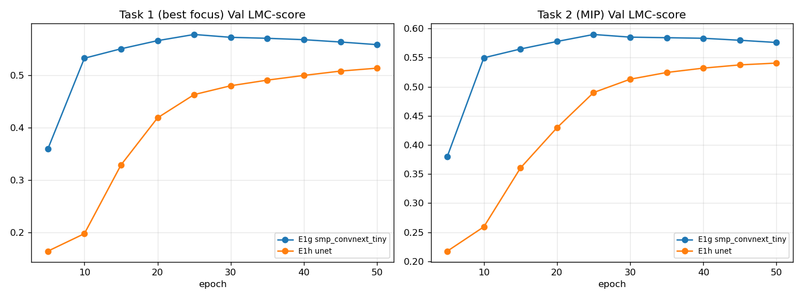

# Task 2 (MIP) Val comparison: E1g, E1h, E1d T1->MIP

Scores at each run's best Val checkpoint (selected on this same Val set: slightly optimistic).

## Headline (organelle columns = study-macro (SSIM+PCC)/2)

| run | LMC (study macro) | LMC (image mean) | LMC w/o S20 | Nucleus | Mitochondria | Tubulin | Actin |
|---|---|---|---|---|---|---|---|
| E1g smp_convnext_tiny | 0.5896 | 0.5572 | 0.6655 | 0.6604 | 0.4913 | 0.5648 | 0.6421 |
| E1h unet | 0.5405 | 0.5095 | 0.6117 | 0.5995 | 0.4493 | 0.5228 | 0.5906 |
| E1d smp_convnext_tiny (Task 1 head scored as MIP) | 0.574 | 0.5322 | 0.6531 | 0.6829 | 0.438 | 0.5377 | 0.6376 |

## (SSIM+PCC)/2 per organelle x modality (image mean)

| organelle | tl | n | E1d T1->MIP | E1g | E1h |
|---|---|---|---|---|---|
| Actin | BF | 10 | 0.707 | 0.687 | 0.642 |
| Actin | PC | 20 | 0.633 | 0.675 | 0.599 |
| Mitochondria | DIC | 23 | 0.304 | 0.343 | 0.277 |
| Mitochondria | PC | 15 | 0.572 | 0.64 | 0.622 |
| Nucleus | BF | 10 | 0.897 | 0.832 | 0.741 |
| Nucleus | DIC | 28 | 0.393 | 0.398 | 0.418 |
| Nucleus | PC | 20 | 0.699 | 0.7 | 0.595 |
| Tubulin | BF | 10 | 0.756 | 0.679 | 0.577 |
| Tubulin | DIC | 28 | 0.309 | 0.385 | 0.395 |
| Tubulin | PC | 15 | 0.599 | 0.641 | 0.561 |

## (SSIM+PCC)/2 per organelle x study

| organelle | study | tl | size | E1d T1->MIP | E1g | E1h |
|---|---|---|---|---|---|---|
| Actin | 72 | PC | 15 | 0.664 | 0.73 | 0.634 |
| Actin | 81 | PC | 5 | 0.541 | 0.509 | 0.496 |
| Actin | 82 | BF | 10 | 0.707 | 0.687 | 0.642 |
| Mitochondria | 20 | DIC | 23 | 0.304 | 0.343 | 0.277 |
| Mitochondria | 72 | PC | 15 | 0.572 | 0.64 | 0.622 |
| Nucleus | 20 | DIC | 23 | 0.324 | 0.343 | 0.382 |
| Nucleus | 72 | PC | 15 | 0.655 | 0.662 | 0.545 |
| Nucleus | 81 | PC | 5 | 0.829 | 0.815 | 0.747 |
| Nucleus | 82 | BF | 10 | 0.897 | 0.832 | 0.741 |
| Nucleus | 86 | DIC | 5 | 0.709 | 0.65 | 0.583 |
| Tubulin | 20 | DIC | 23 | 0.26 | 0.338 | 0.35 |
| Tubulin | 72 | PC | 15 | 0.599 | 0.641 | 0.561 |
| Tubulin | 82 | BF | 10 | 0.756 | 0.679 | 0.577 |
| Tubulin | 86 | DIC | 5 | 0.535 | 0.601 | 0.602 |

## Paired bootstrap of the Task 2 LMC-score difference (images resampled within study x organelle, 2000 draws; study-level columns resample the Val studies within each organelle)

| A | B | LMC(A)-LMC(B) | 95% CI low | 95% CI high | P(A>B) | w/o S20: diff | w/o: CI low | w/o: CI high | study-level CI low | study-level CI high | study-level P(A>B) |
|---|---|---|---|---|---|---|---|---|---|---|---|
| E1g | E1h | 0.0491 | 0.035 | 0.062 | 1.0 | 0.0538 | 0.0383 | 0.0677 | 0.0267 | 0.0693 | 1.0 |
| E1g | E1d T1->MIP | 0.0156 | 0.0066 | 0.0243 | 1.0 | 0.0123 | 0.0021 | 0.0221 | -0.005 | 0.0357 | 0.926 |
| E1h | E1d T1->MIP | -0.0335 | -0.0444 | -0.0221 | 0.0 | -0.0415 | -0.0527 | -0.0301 | -0.0657 | 0.0001 | 0.026 |

